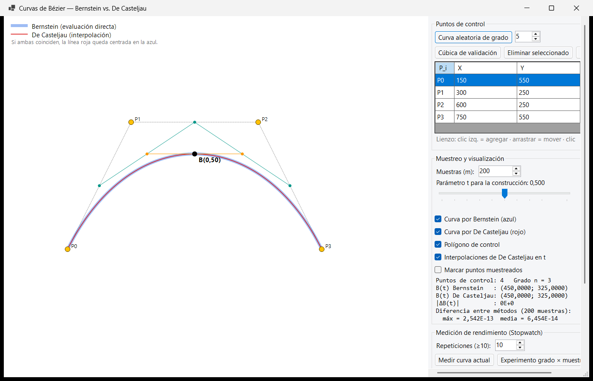
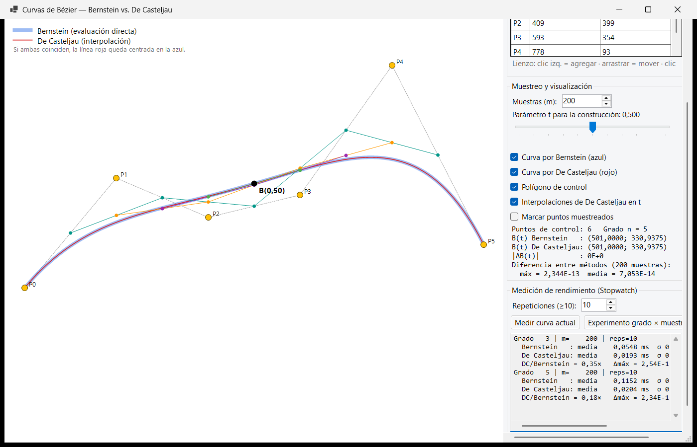
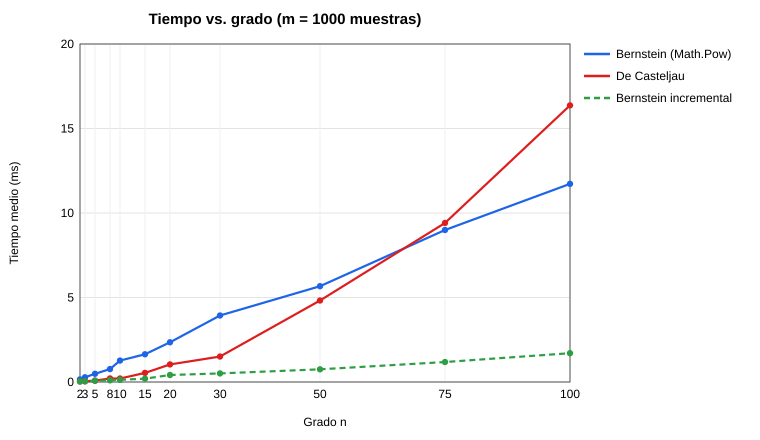
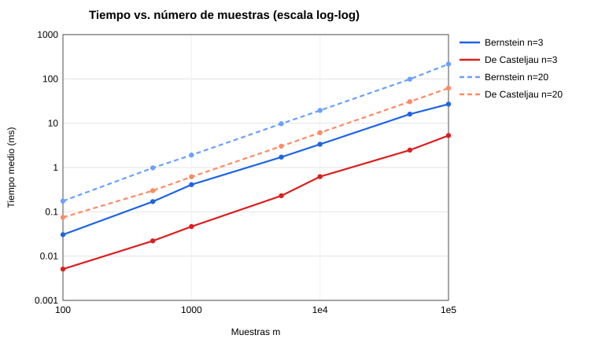
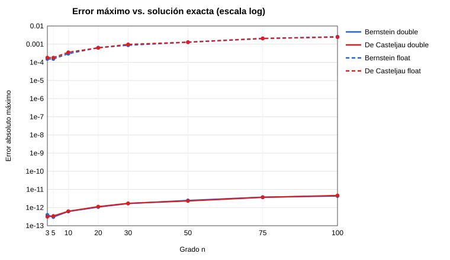

# Informe técnico: evaluación de curvas de Bézier con polinomios de Bernstein y con el algoritmo de De Casteljau

**Autores:** Jose Daniel Villa Andrango, Luis David Castillo Ganchozo, Paulo Alejandro Ramos Vilca

**Pregunta de investigación:** ¿qué método de evaluación de curvas de Bézier es más eficiente y más estable numéricamente según las condiciones de ejecución?

**Entorno de las pruebas:** C# / .NET 10.0.12 (Release, sin JIT escalonado), Windows 11 x64, 12 procesadores lógicos, `System.Diagnostics.Stopwatch` de alta resolución (10 MHz).

---

## 1. Objetivo y alcance

El trabajo analiza, implementa y compara dos formas de evaluar una curva de Bézier:

1. **Evaluación directa** con la base de polinomios de Bernstein.
2. **Algoritmo de De Casteljau**, que evalúa la curva con interpolaciones lineales sucesivas.

Los dos métodos se comparan en tres aspectos: tiempo de ejecución, estabilidad numérica y complejidad computacional. También se implementó una variante optimizada de Bernstein, llamada **Bernstein incremental**, que calcula las potencias con productos sucesivos en lugar de `Math.Pow`. Con ella se puede separar el coste propio del método del coste de la función de potencia.

---

## 2. Fundamentos matemáticos

### 2.1 Curva de Bézier y base de Bernstein

Dados $n+1$ puntos de control $P_0,\dots,P_n \in \mathbb{R}^2$, la curva de Bézier de grado $n$ es

$$
B(t) = \sum_{i=0}^{n} b_{i,n}(t)\,P_i, \qquad t\in[0,1],
$$

donde los **polinomios de Bernstein** son

$$
b_{i,n}(t) = \binom{n}{i}\, t^{i}\,(1-t)^{n-i}.
$$

Propiedades relevantes:

| Propiedad | Enunciado | Consecuencia |
|---|---|---|
| No negatividad | $b_{i,n}(t)\ge 0$ en $[0,1]$ | Los pesos nunca se cancelan |
| Partición de la unidad | $\sum_i b_{i,n}(t) = 1$ | La curva es una combinación afín: es invariante ante transformaciones afines |
| Envolvente convexa | De las dos anteriores | $B(t)$ está dentro de la envolvente convexa de los $P_i$ |
| Interpolación de extremos | $B(0)=P_0$, $B(1)=P_n$ | La curva pasa por el primer y el último punto |
| Simetría | $b_{i,n}(t)=b_{n-i,n}(1-t)$ | Invertir el orden de los puntos recorre la misma curva |
| Recurrencia | $b_{i,n}(t)=(1-t)\,b_{i,n-1}(t)+t\,b_{i-1,n-1}(t)$ | Es la base del algoritmo de De Casteljau |

### 2.2 Algoritmo de De Casteljau

$$
P_i^{(0)} = P_i,\qquad
P_i^{(r)} = (1-t)\,P_i^{(r-1)} + t\,P_{i+1}^{(r-1)},\quad r=1..n,\; i=0..n-r,
\qquad B(t)=P_0^{(n)}.
$$

**Equivalencia con Bernstein.** Por inducción sobre $r$ se cumple $P_i^{(r)}=\sum_{j=0}^{r} b_{j,r}(t)\,P_{i+j}$. Al sustituir en la recurrencia y aplicar la identidad $b_{j,r}=(1-t)\,b_{j,r-1}+t\,b_{j-1,r-1}$ se obtiene el caso $r$. Con $r=n$ e $i=0$ resulta exactamente $B(t)$. Los dos métodos calculan, por tanto, **el mismo polinomio**. Sus resultados solo difieren por el orden de las operaciones de punto flotante.

**Interpretación geométrica.** Cada nivel divide los segmentos del nivel anterior en la proporción $t : (1-t)$. La aplicación dibuja estos niveles (Figura 1). Como subproducto, los puntos $P_0^{(r)}$ y $P_{n-r}^{(r)}$ forman los polígonos de control de las dos mitades de la curva (subdivisión). Esto se implementa en `DeCasteljau.Subdivide`.

### 2.3 Ventajas y desventajas

| | Bernstein (evaluación directa) | De Casteljau |
|---|---|---|
| **Ventajas** | Coste lineal $O(n)$ por punto. Da una fórmula cerrada útil para derivar e integrar. Los pesos $b_{i,n}(t)$ dependen solo de $t$: si muchas curvas del mismo grado se muestrean con los mismos $t$, la tabla de pesos se precalcula una vez. Es fácil de vectorizar. | Usa solo combinaciones convexas (pesos $1-t$ y $t$ en $[0,1]$). Los valores intermedios nunca salen de la envolvente convexa, así que **no hay desbordamiento** en ningún grado. Es geométricamente intuitivo. Ofrece subdivisión gratis. No necesita coeficientes binomiales ni potencias. |
| **Desventajas** | Necesita $\binom{n}{i}$, que crece como $\sim 2^n/\sqrt{n}$ y **desborda** en `double` para $n\ge 1030$ y en `float` para $n\ge 132$. `Math.Pow` es una operación cara. Los factores $t^i$ y $(1-t)^{n-i}$ pueden producir subdesbordamiento ($0\cdot\infty=\text{NaN}$). | Coste cuadrático $O(n^2)$ por punto. Necesita un búfer de trabajo de $n+1$ puntos. |

### 2.4 Complejidad computacional

Sean $n$ el grado y $m$ el número de muestras. Se cuentan operaciones por punto evaluado en 2D:

| Método | Operaciones por punto | Por curva completa | Memoria extra |
|---|---|---|---|
| Bernstein con `Math.Pow` | $2(n+1)$ llamadas a `pow` + $\approx 4(n+1)$ productos y sumas | $O(m\,n)$ + $O(n^2)$ (Pascal, una vez) | $O(n)$ |
| Bernstein incremental | $2n$ productos (potencias) + $\approx 4(n+1)$ productos y sumas $\approx 6n$ flops | $O(m\,n)$ | $O(n)$ |
| De Casteljau | $\frac{n(n+1)}{2}$ interpolaciones × 2 coordenadas × 3 flops $= 3n(n+1)$ flops | $O(m\,n^2)$ | $O(n)$ |

Para una cúbica ($n=3$), De Casteljau necesita 36 flops y Bernstein con `pow` necesita 8 llamadas a `pow` (cada una equivale a decenas de flops). Por eso De Casteljau gana en grados bajos aunque su orden asintótico sea peor. El cruce teórico ocurre cuando $3n(n+1)\,c_{flop} \approx 2(n+1)\,c_{pow}$, es decir, en $n \approx \tfrac{2}{3}\,c_{pow}/c_{flop}$. La sección 5 lo verifica de forma empírica.

---

## 3. Validación matemática: cúbica calculada a mano

Puntos de control: $P_0=(0,0)$, $P_1=(1,2)$, $P_2=(3,2)$, $P_3=(4,0)$.

### 3.1 Método de Bernstein

Para $n=3$: $b_0=(1-t)^3$, $b_1=3t(1-t)^2$, $b_2=3t^2(1-t)$, $b_3=t^3$.

**t = 0.25** ($1-t=0.75$):

- $b_0 = 0.75^3 = 0.421875$
- $b_1 = 3(0.25)(0.5625) = 0.421875$
- $b_2 = 3(0.0625)(0.75) = 0.140625$
- $b_3 = 0.015625$ (suma $=1$ ✔)
- $x = 0.421875\cdot0 + 0.421875\cdot1 + 0.140625\cdot3 + 0.015625\cdot4 = 0.421875+0.421875+0.0625 = \mathbf{0.90625}$
- $y = 0.421875\cdot2 + 0.140625\cdot2 = \mathbf{1.125}$

**t = 0.5:** $b=(0.125,\;0.375,\;0.375,\;0.125)$

- $x = 0.375 + 1.125 + 0.5 = \mathbf{2}$
- $y = 0.75 + 0.75 = \mathbf{1.5}$

**t = 0.75:** $b=(0.015625,\;0.140625,\;0.421875,\;0.421875)$

- $x = 0.140625 + 1.265625 + 1.6875 = \mathbf{3.09375}$
- $y = 0.28125 + 0.84375 = \mathbf{1.125}$

### 3.2 Método de De Casteljau

**t = 0.25**

| Nivel | Cálculo | Resultado |
|---|---|---|
| r=1 | $0.75P_0+0.25P_1$; $0.75P_1+0.25P_2$; $0.75P_2+0.25P_3$ | $(0.25,0.5)$; $(1.5,2)$; $(3.25,1.5)$ |
| r=2 | $0.75(0.25,0.5)+0.25(1.5,2)$; $0.75(1.5,2)+0.25(3.25,1.5)$ | $(0.5625,0.875)$; $(1.9375,1.875)$ |
| r=3 | $0.75(0.5625,0.875)+0.25(1.9375,1.875)$ | $\mathbf{(0.90625,\;1.125)}$ |

**t = 0.5**

| Nivel | Resultado |
|---|---|
| r=1 | $(0.5,1)$; $(2,2)$; $(3.5,1)$ |
| r=2 | $(1.25,1.5)$; $(2.75,1.5)$ |
| r=3 | $\mathbf{(2,\;1.5)}$ |

**t = 0.75**

| Nivel | Resultado |
|---|---|
| r=1 | $(0.75,1.5)$; $(2.5,2)$; $(3.75,0.5)$ |
| r=2 | $(2.0625,1.875)$; $(3.4375,0.875)$ |
| r=3 | $\mathbf{(3.09375,\;1.125)}$ |

### 3.3 Comparación con el programa

| t | A mano (ambos métodos) | Programa: Bernstein | Programa: De Casteljau |
|---|---|---|---|
| 0 | (0, 0) | (0, 0) | (0, 0) |
| 0.25 | (0.90625, 1.125) | (0.90625, 1.125) | (0.90625, 1.125) |
| 0.5 | (2, 1.5) | (2, 1.5) | (2, 1.5) |
| 0.75 | (3.09375, 1.125) | (3.09375, 1.125) | (3.09375, 1.125) |
| 1 | (4, 0) | (4, 0) | (4, 0) |

Los resultados coinciden exactamente. Para estos valores de $t$ todas las operaciones son exactas en binario, así que no hay redondeo. La salida completa, con los niveles intermedios, está en `resultados/resultados.md`, sección 0. La simetría $B(0.25)_y = B(0.75)_y$ confirma la propiedad de simetría, porque el polígono es simétrico respecto de $x=2$.

---

## 4. Implementación

### 4.1 Arquitectura

```
BezierComparacion.slnx
├── src/BezierCore        Biblioteca de algoritmos (sin dependencias gráficas)
│   ├── PointD.cs           Punto 2D propio (double y float) y muestreo t_k = k/(m-1)
│   ├── Bernstein.cs        Evaluación directa (Math.Pow) + variante incremental + float
│   ├── DeCasteljau.cs      Evaluación, niveles de interpolación, subdivisión, float
│   ├── ExactReference.cs   Evaluación EXACTA con aritmética racional (BigInteger)
│   └── Metrics.cs          Medición con Stopwatch y diferencias numéricas
├── src/BezierApp         Aplicación gráfica WinForms
└── src/BezierBenchmark   Banco de pruebas por consola (CSV, tablas Markdown, gráficos SVG)
```

**Restricción respetada:** los algoritmos están en `BezierCore`, que no referencia ninguna API gráfica. La aplicación no usa `Graphics.DrawBezier`, `GraphicsPath.AddBezier` ni ninguna función equivalente. Solo une con `DrawLines` (una polilínea de segmentos rectos) los puntos que ya calcularon los algoritmos propios.

### 4.2 Aplicación gráfica (requerimientos)

| Requerimiento | Cómo se cumple |
|---|---|
| Agregar, eliminar y modificar puntos de control | Clic izquierdo en el lienzo agrega un punto. Arrastrar lo mueve. Clic derecho lo elimina. La tabla permite editar X e Y y borrar filas. También hay botones *Eliminar seleccionado* y *Limpiar*. |
| Curvas de distintos grados | Grado arbitrario (un punto por clic). El botón *Curva aleatoria de grado n* acepta de 1 a 100. El botón *Cúbica de validación* carga la cúbica de la sección 3. |
| Ver ambos algoritmos a la vez | Bernstein se dibuja con un trazo azul grueso y semitransparente. De Casteljau se dibuja encima con un trazo rojo fino. Cuando coinciden, la línea roja queda centrada en la azul. |
| Configurar la cantidad de muestras | Control *Muestras (m)*, de 2 a 200 000. |
| Ver las interpolaciones de De Casteljau | Un deslizador de $t$ muestra los niveles $r=1..n-1$, cada uno con su color, y el punto $B(t)$. |
| Medir con Stopwatch | El botón *Medir curva actual* ejecuta N≥10 repeticiones (más 2 de calentamiento) en un hilo de fondo. El botón *Experimento grado × muestras* ejecuta un barrido completo. Ambos permiten exportar a CSV. |
| Diferencias numéricas | El panel muestra $\lvert\Delta B(t)\rvert$ y las diferencias máxima y media entre los dos muestreos, y avisa si aparecen NaN o ∞. |





### 4.3 Metodología de medición

- Solo se cronometra el cálculo de los $m$ puntos (`EvaluateCurve`, que escribe en un arreglo ya reservado). **La representación gráfica queda fuera de la medición.**
- Cada prueba tiene 5 corridas de calentamiento (descartadas) y luego **30 repeticiones medidas** (el mínimo exigido es 10). Se reportan la media, la desviación estándar σ, el mínimo, el máximo y la mediana, y en el CSV quedan todas las corridas individuales.
- Se compila en modo Release con `TieredCompilation=false`, para que todas las corridas ejecuten código JIT totalmente optimizado. Las primeras pruebas, con JIT escalonado, daban σ del mismo orden que la media.
- Los puntos de control son aleatorios, con coordenadas enteras en $[0,1000]$ y semilla fija (resultados reproducibles).
- **Diferencia numérica:** distancia euclidiana punto a punto entre los muestreos de los dos métodos.
- **Error absoluto:** distancia al valor **exacto**. Se calcula con De Casteljau en aritmética racional (`BigInteger`). Todo `double` es un racional $m\cdot2^e$, así que la referencia no introduce ningún redondeo.

---

## 5. Resultados experimentales

> Datos completos en `resultados/tiempos.csv`, `resultados/precision.csv`, `resultados/grados_extremos.csv` y `resultados/resultados.md`.

### 5.1 Tiempo frente al grado (m = 1000 muestras, 30 repeticiones)

| Grado n | Bernstein `pow` (ms) | σ | De Casteljau (ms) | σ | DC / Bernstein | Bernstein incremental (ms) |
|---:|---:|---:|---:|---:|---:|---:|
| 2 | 0.199 | 0.019 | **0.045** | 0.004 | 0.23× | 0.065 |
| 3 | 0.260 | 0.005 | **0.079** | 0.008 | 0.30× | 0.090 |
| 5 | 0.444 | 0.049 | 0.171 | 0.009 | 0.39× | **0.111** |
| 8 | 0.688 | 0.047 | 0.179 | 0.027 | 0.26× | **0.162** |
| 10 | 0.910 | 0.152 | **0.237** | 0.034 | 0.26× | 0.263 |
| 15 | 1.329 | 0.190 | 0.440 | 0.051 | 0.33× | **0.291** |
| 20 | 1.727 | 0.157 | 0.766 | 0.177 | 0.44× | **0.406** |
| 30 | 2.584 | 0.203 | 1.371 | 0.097 | 0.53× | **0.605** |
| 50 | 5.023 | 1.066 | 4.183 | 0.953 | 0.83× | **1.049** |
| 75 | 7.083 | 1.162 | 9.139 | 2.041 | 1.29× | **1.456** |
| 100 | 9.006 | 1.365 | 14.053 | 0.726 | 1.56× | **2.074** |



### 5.2 Tiempo frente al número de muestras (30 repeticiones)

| n | m | Bernstein `pow` (ms) | De Casteljau (ms) | Incremental (ms) | Bernstein ns/punto | DC ns/punto |
|---:|---:|---:|---:|---:|---:|---:|
| 3 | 100 | 0.026 | 0.008 | 0.007 | 261 | 83 |
| 3 | 1 000 | 0.260 | 0.082 | 0.075 | 260 | 82 |
| 3 | 10 000 | 2.704 | 0.693 | 0.762 | 270 | 69 |
| 3 | 100 000 | 28.487 | 6.974 | 7.577 | 285 | 70 |
| 20 | 100 | 0.164 | 0.077 | 0.055 | 1 640 | 774 |
| 20 | 1 000 | 1.725 | 0.691 | 0.421 | 1 725 | 691 |
| 20 | 10 000 | 17.486 | 9.965 | 4.147 | 1 749 | 997 |
| 20 | 100 000 | 180.198 | 77.512 | 41.937 | 1 802 | 775 |



### 5.3 Matriz grado × muestras (media ± σ en ms, 30 repeticiones)

| n | m | Bernstein `pow` | De Casteljau | Más rápido (`pow` frente a DC) | Bernstein incremental | Δmáx entre métodos |
|---:|---:|---:|---:|:---:|---:|---:|
| 3 | 100 | 0.029 ± 0.003 | 0.006 ± 0.000 | DC (4.6×) | 0.007 ± 0.000 | 2.5E-13 |
| 3 | 1 000 | 0.298 ± 0.063 | 0.067 ± 0.006 | DC (4.5×) | 0.073 ± 0.007 | 3.2E-13 |
| 3 | 10 000 | 2.712 ± 0.237 | 0.673 ± 0.093 | DC (4.0×) | 0.718 ± 0.073 | 4.1E-13 |
| 5 | 100 | 0.046 ± 0.007 | 0.010 ± 0.001 | DC (4.5×) | 0.016 ± 0.007 | 3.8E-13 |
| 5 | 1 000 | 0.433 ± 0.023 | 0.102 ± 0.007 | DC (4.2×) | 0.111 ± 0.013 | 4.7E-13 |
| 5 | 10 000 | 4.595 ± 0.491 | 1.074 ± 0.169 | DC (4.3×) | 1.080 ± 0.156 | 4.1E-13 |
| 10 | 100 | 0.107 ± 0.033 | 0.035 ± 0.006 | DC (3.1×) | 0.020 ± 0.003 | 2.5E-13 |
| 10 | 1 000 | 0.928 ± 0.224 | 0.244 ± 0.036 | DC (3.8×) | 0.208 ± 0.040 | 4.7E-13 |
| 10 | 10 000 | 9.648 ± 1.184 | 2.622 ± 0.519 | DC (3.7×) | 2.214 ± 0.468 | 4.7E-13 |
| 20 | 100 | 0.267 ± 0.130 | 0.078 ± 0.021 | DC (3.4×) | 0.039 ± 0.004 | 3.6E-13 |
| 20 | 1 000 | 1.922 ± 0.568 | 0.801 ± 0.396 | DC (2.4×) | 0.423 ± 0.111 | 5.9E-13 |
| 20 | 10 000 | 18.549 ± 1.451 | 7.196 ± 0.833 | DC (2.6×) | 4.208 ± 0.797 | 7.6E-13 |
| 50 | 100 | 0.419 ± 0.068 | 0.433 ± 0.185 | ≈ empate | 0.120 ± 0.050 | 4.8E-13 |
| 50 | 1 000 | 4.522 ± 0.643 | 3.751 ± 0.555 | DC (1.2×) | 1.011 ± 0.185 | 9.1E-13 |
| 50 | 10 000 | 43.822 ± 1.199 | 36.361 ± 2.161 | DC (1.2×) | 10.267 ± 0.970 | 1.0E-12 |

### 5.4 Error respecto a la solución exacta (m = 101, coordenadas en [0,1000])

| Grado n | Bernstein `double` máx | Incremental `double` máx | De Casteljau `double` máx | Bernstein `float` máx | De Casteljau `float` máx |
|---:|---:|---:|---:|---:|---:|
| 3 | 3.94E-13 | 3.94E-13 | 3.13E-13 | 1.53E-04 | 1.81E-04 |
| 5 | 3.01E-13 | 2.94E-13 | 3.44E-13 | 1.53E-04 | 1.80E-04 |
| 10 | 6.10E-13 | 6.07E-13 | 6.25E-13 | 2.98E-04 | 3.58E-04 |
| 20 | 1.07E-12 | 1.13E-12 | 1.13E-12 | 6.44E-04 | 6.21E-04 |
| 30 | 1.67E-12 | 1.69E-12 | 1.71E-12 | 8.70E-04 | 9.70E-04 |
| 50 | 2.48E-12 | 2.44E-12 | 2.31E-12 | 1.28E-03 | 1.29E-03 |
| 75 | 3.75E-12 | 3.69E-12 | 3.66E-12 | 2.03E-03 | 2.08E-03 |
| 100 | 4.31E-12 | 4.23E-12 | 4.63E-12 | 2.57E-03 | 2.44E-03 |

Unidad de redondeo: `double` $u=2^{-53}\approx1.1\cdot10^{-16}$ (×1000 = $1.1\cdot10^{-13}$); `float` $u=2^{-24}\approx6\cdot10^{-8}$ (×1000 = $6\cdot10^{-5}$).



### 5.5 Grados extremos: desbordamiento (m = 201)

| Precisión | Grado n | máx $\binom{n}{i}$ | Puntos NaN/∞ con Bernstein | Puntos NaN/∞ con De Casteljau |
|---|---:|---:|---:|---:|
| double | 1000 | 2.70E+299 | 0 / 201 | 0 / 201 |
| double | 1029 | 1.43E+308 | 0 / 201 | 0 / 201 |
| double | **1030** | **∞** | **201 / 201** | 0 / 201 |
| double | 1100 | ∞ | 201 / 201 | 0 / 201 |
| float | 130 | 9.51E+37 | 0 / 201 | 0 / 201 |
| float | **135** | **∞** | **201 / 201** | 0 / 201 |
| float | 150 | ∞ | 201 / 201 | 0 / 201 |

En `float`, $\binom{132}{66}\approx3.8\cdot10^{38}$ ya supera el máximo representable ($3.4\cdot10^{38}$), así que el fallo empieza en $n=132$.

---

## 6. Análisis

### 6.1 Rendimiento

1. **Grado bajo (n ≤ 20, el caso habitual en gráficos: cuadráticas y cúbicas).** De Casteljau es entre **2.4 y 4.6 veces más rápido** que Bernstein con `Math.Pow` en todas las combinaciones de la matriz. Una cúbica cuesta unos 70 ns por punto con De Casteljau y unos 270 ns con Bernstein. La diferencia viene de `pow`, que es mucho más cara que una multiplicación, y no del orden asintótico. Con la variante incremental, Bernstein queda prácticamente empatado con De Casteljau en n = 3 a 10 (dentro de σ).
2. **Grado medio (n ≈ 30 a 50).** El término $n^2$ de De Casteljau empieza a pesar. Con m = 1000, el cociente DC/Bernstein `pow` sube de 0.44× (n = 20) a 0.83× (n = 50), y De Casteljau ya es 4 veces más lento que Bernstein incremental.
3. **Grado alto (n ≥ 75).** De Casteljau es más lento que las dos variantes de Bernstein (1.3 a 1.6 veces frente a `pow`, unas 7 veces frente a la incremental). El cruce medido con `pow` está entre n = 50 y n = 75.
4. **Escalado con las muestras.** Para un grado fijo, el tiempo por punto (ns/punto) es prácticamente constante de m = 100 a m = 100 000. Las pendientes de la Figura 4 son paralelas y de valor 1 en log-log: los tres métodos son **lineales en m**. El número de muestras no cambia cuál método gana. Solo multiplica los tiempos.

**Complejidad empírica frente al grado.** Entre n = 50 y n = 100:

- De Casteljau pasa de 4.18 a 14.05 ms (×3.4). Lo esperado para $O(n^2)$ es ×4.
- Bernstein incremental pasa de 1.05 a 2.07 ms (×2.0). Lo esperado para $O(n)$ es ×2.
- Bernstein con `pow` pasa de 5.0 a 9.0 ms (×1.8), también lineal.

Las mediciones confirman el análisis de la sección 2.4.

### 6.2 Estabilidad numérica

1. **En el rango normal (`double`, n ≤ 100) los dos métodos son igual de precisos.** El error máximo frente a la solución exacta crece de forma aproximadamente lineal con n: de $\sim4\cdot10^{-13}$ en n = 3 a $\sim4.5\cdot10^{-12}$ en n = 100, es decir, del orden de $n\cdot u\cdot\max|P_i|$. Ningún método domina de forma sistemática: las diferencias entre filas son del mismo orden que la variación aleatoria. Esto coincide con lo que se sabe en la teoría: los dos métodos son estables hacia atrás para la base de Bernstein, porque solo suman términos no negativos (Farouki y Rajan, 1987). La diferencia entre los dos métodos ($\le10^{-12}$ en coordenadas de hasta 1000 píxeles) es unas **$10^{9}$ veces menor que un píxel** y visualmente nula.
2. **En `float`** los errores suben a $10^{-4}$–$10^{-3}$, entre 3 y 40 veces $u\cdot1000$. Siguen siendo invisibles en pantalla y los dos métodos vuelven a ser equivalentes.
3. **Robustez: aquí está la diferencia decisiva.** La evaluación directa depende de $\binom{n}{i}$, que desborda a ∞:
   - En $n \ge 1030$ (`double`) y en $n \ge 132$ (`float`), el **100 % de los puntos** calculados por Bernstein son NaN, porque $\infty\cdot0$ o $\infty\cdot$ (un número diminuto) no tiene valor definido.
   - De Casteljau no falla en ningún caso. Solo usa combinaciones convexas, así que sus valores intermedios están acotados por $\max|P_i|$ y nunca puede desbordar.
   - Antes de llegar al desbordamiento, Bernstein ya multiplica números enormes por números diminutos ($\binom{1000}{500}\approx10^{299}$ por $0.5^{1000}\approx10^{-301}$). Este fenómeno no aparece en De Casteljau.

### 6.3 Síntesis de la complejidad

| Criterio | Bernstein `pow` | Bernstein incremental | De Casteljau |
|---|---|---|---|
| Orden por punto | $O(n)$ | $O(n)$ | $O(n^2)$ |
| Constante | Alta (llamadas a `pow`) | Baja | Baja |
| Coste medido, cúbica (ns/punto) | ≈ 270 | ≈ 75 | ≈ 70 |
| Coste medido, n = 100 (ns/punto) | ≈ 9 000 | ≈ 2 100 | ≈ 14 000 |
| Grado máximo utilizable (`double`) | 1029 | 1029 | Sin límite |
| Error típico (`double`, n ≤ 100) | $\sim n\,u\,\lVert P\rVert$ | $\sim n\,u\,\lVert P\rVert$ | $\sim n\,u\,\lVert P\rVert$ |

---

## 7. Conclusiones

**Respuesta a la pregunta de investigación.** Ningún método es el mejor en todas las condiciones. La elección depende del grado y de las prioridades:

| Escenario | Recomendación | Justificación |
|---|---|---|
| Gráficos interactivos y CAD con cuadráticas y cúbicas (fuentes, SVG, trayectorias de animación) | **De Casteljau** | Es de 3 a 5 veces más rápido que Bernstein con `pow`, nunca desborda, ofrece subdivisión y es fácil de verificar visualmente. |
| Grado bajo o medio cuando el rendimiento es crítico | **Bernstein incremental** (o con pesos precalculados) | Tiene el mismo coste que De Casteljau en grados bajos y es hasta 7 veces más rápido en n ≥ 50. Si muchas curvas del mismo grado comparten los mismos $t$, la tabla de pesos $b_{i,n}(t_k)$ se calcula una sola vez. |
| Grado alto (n ≳ 50) en `double` y lejos del límite de desbordamiento | **Bernstein incremental** | Coste $O(n)$ frente a $O(n^2)$, con la misma precisión medida. |
| Grado muy alto, precisión simple (`float`, GPU) o cuando se necesita robustez garantizada | **De Casteljau** | Bernstein falla por completo (NaN) a partir de n = 132 en `float` y de n = 1030 en `double`. De Casteljau funciona en cualquier grado. |
| Subdivisión, intersección de curvas, recorte, construcción geométrica | **De Casteljau** | La subdivisión es un subproducto gratuito del propio algoritmo. |
| Bernstein implementado de forma ingenua con `Math.Pow` | **No recomendado** | Es el más lento en casi todos los casos medidos y no es más preciso. |

**En resumen:**

- **Eficiencia.** Asintóticamente gana la evaluación directa de Bernstein ($O(n)$ frente a $O(n^2)$), pero solo si se implementa sin `Math.Pow`. Para los grados que se usan en la práctica (n ≤ 20), De Casteljau es igual de rápido o más rápido.
- **Estabilidad numérica.** En condiciones normales los dos métodos tienen errores equivalentes, del orden de $n\cdot u$, y producen diferencias imperceptibles ($<10^{-11}$ px). **De Casteljau es el más estable** porque es el único inmune al desbordamiento de los coeficientes binomiales y a los productos entre números enormes y diminutos. Por eso es la opción por defecto más segura y la que usan la mayoría de los sistemas gráficos y de CAD.

---

## 8. Reproducción

Compilar la solución:

```powershell
dotnet build BezierComparacion.slnx -c Release
```

Abrir la aplicación gráfica:

```powershell
dotnet run -c Release --project src/BezierApp
```

Ejecutar los experimentos (carpeta de salida y número de repeticiones, mínimo 10):

```powershell
dotnet run -c Release --project src/BezierBenchmark -- resultados 30
```

Los tiempos absolutos dependen del equipo. Las tendencias (cruce de rendimiento, lineal frente a cuadrático, desbordamiento) se mantienen.

## 9. Referencias

- Farin, G. (2002). *Curves and Surfaces for CAGD: A Practical Guide* (5.ª ed.). Morgan Kaufmann.
- Piegl, L., y Tiller, W. (1997). *The NURBS Book* (2.ª ed.). Springer.
- Farouki, R. T., y Rajan, V. T. (1987). On the numerical condition of polynomials in Bernstein form. *Computer Aided Geometric Design, 4*(3), 191–216.
- Farouki, R. T. (2012). The Bernstein polynomial basis: A centennial retrospective. *Computer Aided Geometric Design, 29*(6), 379–419.
- Higham, N. J. (2002). *Accuracy and Stability of Numerical Algorithms* (2.ª ed.). SIAM.

## Repositorio del proyecto

El código fuente, los resultados y este informe están disponibles en: <https://github.com/AjvDani/curvas-bezier.git>
