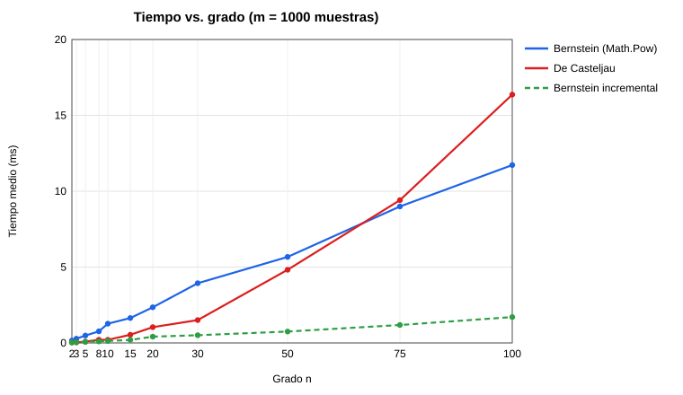
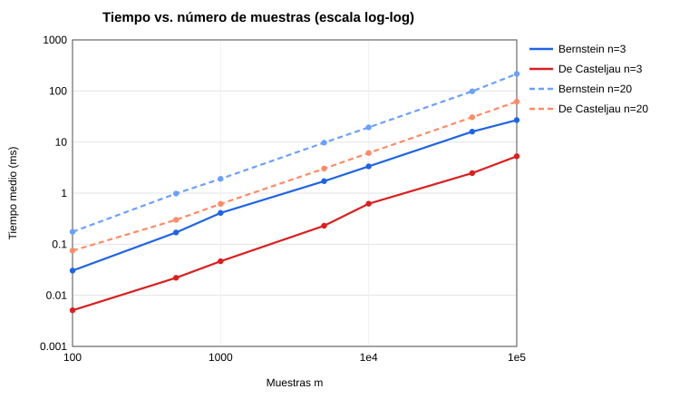
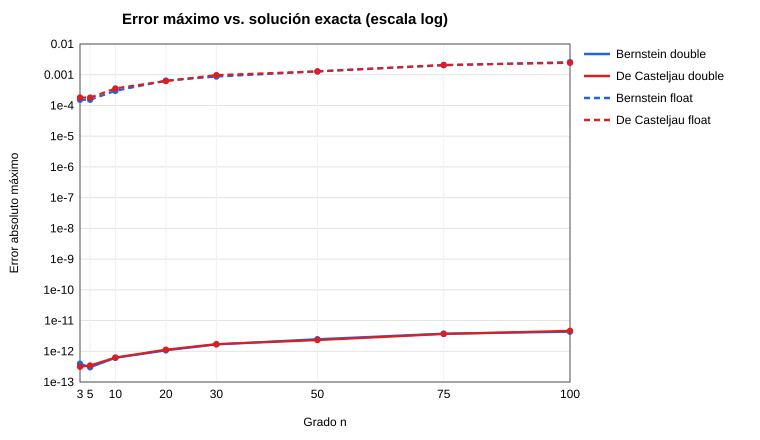

# Resultados experimentales — Bernstein vs. De Casteljau

- Fecha: 2026-11-26 12:27
- Runtime: .NET 10.0.13, Microsoft Windows 10.0.19045, X64
- Procesadores lógicos: 4
- Stopwatch: alta resolución = True, frecuencia = 10,000,000 Hz
- Repeticiones por prueba: 30 (más 5 corridas de calentamiento no contabilizadas)
- Puntos de control aleatorios con coordenadas enteras en [0, 1000] y semilla fija (reproducible).

## 0. Validación de la cúbica de ejemplo

P0=(0,0), P1=(1,2), P2=(3,2), P3=(4,0)

| t | b0 | b1 | b2 | b3 | Bernstein | De Casteljau | Niveles De Casteljau |
|---|---|---|---|---|---|---|---|
| 0 | 1 | 0 | 0 | 0 | (0, 0) | (0, 0) | (0, 0) (1, 2) (3, 2) → (0, 0) (1, 2) → (0, 0) |
| 0.25 | 0.421875 | 0.421875 | 0.140625 | 0.015625 | (0.90625, 1.125) | (0.90625, 1.125) | (0.25, 0.5) (1.5, 2) (3.25, 1.5) → (0.5625, 0.875) (1.9375, 1.875) → (0.90625, 1.125) |
| 0.5 | 0.125 | 0.375 | 0.375 | 0.125 | (2, 1.5) | (2, 1.5) | (0.5, 1) (2, 2) (3.5, 1) → (1.25, 1.5) (2.75, 1.5) → (2, 1.5) |
| 0.75 | 0.015625 | 0.140625 | 0.421875 | 0.421875 | (3.09375, 1.125) | (3.09375, 1.125) | (0.75, 1.5) (2.5, 2) (3.75, 0.5) → (2.0625, 1.875) (3.4375, 0.875) → (3.09375, 1.125) |
| 1 | 0 | 0 | 0 | 1 | (4, 0) | (4, 0) | (1, 2) (3, 2) (4, 0) → (3, 2) (4, 0) → (4, 0) |

## A. Tiempo de ejecución vs. grado (m = 1000 muestras, 30 repeticiones)

| Grado n | Bernstein media (ms) | σ | De Casteljau media (ms) | σ | DC / Bernstein | Bernstein incremental (ms) | Δmáx entre métodos |
|---:|---:|---:|---:|---:|---:|---:|---:|
| 2 | 0.1553 | 0.0213 | 0.0304 | 0.0022 | 0.20× | 0.0349 | 2.34E-13 |
| 3 | 0.2793 | 0.0486 | 0.0407 | 0.0035 | 0.15× | 0.0417 | 2.34E-13 |
| 5 | 0.4859 | 0.0670 | 0.0832 | 0.0141 | 0.17× | 0.0714 | 3.41E-13 |
| 8 | 0.7650 | 0.0610 | 0.2099 | 0.1014 | 0.27× | 0.0985 | 4.10E-13 |
| 10 | 1.2688 | 0.1821 | 0.2065 | 0.0118 | 0.16× | 0.1295 | 4.10E-13 |
| 15 | 1.6413 | 0.1916 | 0.5383 | 0.1479 | 0.33× | 0.1968 | 5.08E-13 |
| 20 | 2.3506 | 0.3569 | 1.0405 | 0.0722 | 0.44× | 0.4144 | 5.80E-13 |
| 30 | 3.9354 | 0.6433 | 1.5067 | 0.3444 | 0.38× | 0.5085 | 5.80E-13 |
| 50 | 5.6694 | 0.7803 | 4.8220 | 1.2556 | 0.85× | 0.7500 | 7.03E-13 |
| 75 | 8.9947 | 1.2009 | 9.4113 | 2.1627 | 1.05× | 1.1819 | 9.65E-13 |
| 100 | 11.7241 | 1.3509 | 16.3689 | 3.4151 | 1.40× | 1.7047 | 9.09E-13 |

## B. Tiempo de ejecución vs. número de muestras (30 repeticiones)

| Grado n | Muestras m | Bernstein (ms) | De Casteljau (ms) | Bernstein incremental (ms) | Bernstein ns/punto | De Casteljau ns/punto | DC / Bernstein |
|---:|---:|---:|---:|---:|---:|---:|---:|
| 3 | 100 | 0.0305 | 0.0051 | 0.0088 | 304.6 | 50.9 | 0.17× |
| 3 | 500 | 0.1699 | 0.0220 | 0.0225 | 339.7 | 44.1 | 0.13× |
| 3 | 1000 | 0.4100 | 0.0464 | 0.0509 | 410.0 | 46.4 | 0.11× |
| 3 | 5000 | 1.7169 | 0.2301 | 0.2472 | 343.4 | 46.0 | 0.13× |
| 3 | 10000 | 3.3429 | 0.6211 | 0.6163 | 334.3 | 62.1 | 0.19× |
| 3 | 50000 | 15.9990 | 2.4675 | 2.5253 | 320.0 | 49.4 | 0.15× |
| 3 | 100000 | 26.9374 | 5.2681 | 4.3785 | 269.4 | 52.7 | 0.20× |
| 20 | 100 | 0.1749 | 0.0749 | 0.0245 | 1748.8 | 748.7 | 0.43× |
| 20 | 500 | 0.9810 | 0.3001 | 0.1153 | 1962.0 | 600.1 | 0.31× |
| 20 | 1000 | 1.9068 | 0.6158 | 0.2308 | 1906.8 | 615.8 | 0.32× |
| 20 | 5000 | 9.7193 | 3.0244 | 1.1554 | 1943.9 | 604.9 | 0.31× |
| 20 | 10000 | 19.4095 | 6.1049 | 2.5645 | 1940.9 | 610.5 | 0.31× |
| 20 | 50000 | 98.5054 | 30.6428 | 12.6927 | 1970.1 | 612.9 | 0.31× |
| 20 | 100000 | 216.3125 | 61.9219 | 25.7941 | 2163.1 | 619.2 | 0.29× |

## C. Matriz de pruebas grado × muestras (30 repeticiones; media ± σ en ms)

| Grado n | Muestras m | Bernstein (Math.Pow) | De Casteljau | Más rápido (Pow vs DC) | Bernstein incremental | Δmáx | Δmedia |
|---:|---:|---:|---:|:---:|---:|---:|---:|
| 3 | 100 | 0.0246 ± 0.0034 | 0.0045 ± 0.0017 | De Casteljau (5.47×) | 0.0052 ± 0.0028 | 2.54E-13 | 8.30E-14 |
| 3 | 1000 | 0.2467 ± 0.0171 | 0.0437 ± 0.0115 | De Casteljau (5.65×) | 0.0426 ± 0.0053 | 3.22E-13 | 8.01E-14 |
| 3 | 10000 | 2.6869 ± 0.1738 | 0.4646 ± 0.0671 | De Casteljau (5.78×) | 0.4481 ± 0.0332 | 4.10E-13 | 7.91E-14 |
| 5 | 100 | 0.0485 ± 0.0072 | 0.0082 ± 0.0002 | De Casteljau (5.92×) | 0.0097 ± 0.0029 | 3.81E-13 | 1.02E-13 |
| 5 | 1000 | 0.4795 ± 0.0691 | 0.0700 ± 0.0046 | De Casteljau (6.85×) | 0.0698 ± 0.0155 | 4.69E-13 | 9.22E-14 |
| 5 | 10000 | 4.9527 ± 0.7381 | 0.7441 ± 0.0464 | De Casteljau (6.66×) | 0.5731 ± 0.0089 | 4.10E-13 | 9.47E-14 |
| 10 | 100 | 0.1315 ± 0.0341 | 0.0223 ± 0.0040 | De Casteljau (5.90×) | 0.0140 ± 0.0035 | 2.54E-13 | 9.97E-14 |
| 10 | 1000 | 1.1451 ± 0.1045 | 0.2333 ± 0.0615 | De Casteljau (4.91×) | 0.1405 ± 0.0360 | 4.69E-13 | 1.07E-13 |
| 10 | 10000 | 10.0063 ± 1.3213 | 2.0187 ± 0.0900 | De Casteljau (4.96×) | 1.1540 ± 0.1332 | 4.69E-13 | 1.04E-13 |
| 20 | 100 | 0.1749 ± 0.0099 | 0.0597 ± 0.0050 | De Casteljau (2.93×) | 0.0257 ± 0.0059 | 3.60E-13 | 1.45E-13 |
| 20 | 1000 | 1.9806 ± 0.2184 | 0.5938 ± 0.0187 | De Casteljau (3.34×) | 0.2245 ± 0.0031 | 5.93E-13 | 1.51E-13 |
| 20 | 10000 | 19.2922 ± 0.7954 | 6.0289 ± 0.3173 | De Casteljau (3.20×) | 2.3134 ± 0.1083 | 7.63E-13 | 1.52E-13 |
| 50 | 100 | 0.4442 ± 0.0263 | 0.3376 ± 0.0286 | De Casteljau (1.32×) | 0.0597 ± 0.0070 | 4.82E-13 | 1.93E-13 |
| 50 | 1000 | 5.2060 ± 0.4412 | 4.6371 ± 1.1845 | De Casteljau (1.12×) | 0.7528 ± 0.1985 | 9.09E-13 | 2.08E-13 |
| 50 | 10000 | 50.0458 ± 5.0490 | 34.8754 ± 2.9585 | De Casteljau (1.43×) | 5.6140 ± 0.0932 | 1.03E-12 | 2.11E-13 |

## D. Error respecto a la solución exacta (m = 101 muestras, coordenadas en [0,1000])

Error = distancia euclidiana entre el punto calculado y el valor exacto obtenido con aritmética racional (BigInteger).

| Grado n | Bernstein double máx | Bernstein incremental double máx | De Casteljau double máx | Bernstein double medio | De Casteljau double medio | Bernstein float máx | De Casteljau float máx |
|---:|---:|---:|---:|---:|---:|---:|---:|
| 3 | 3.94E-13 | 3.94E-13 | 3.13E-13 | 9.74E-14 | 9.24E-14 | 1.53E-04 | 1.81E-04 |
| 5 | 3.01E-13 | 2.94E-13 | 3.44E-13 | 7.68E-14 | 9.09E-14 | 1.53E-04 | 1.80E-04 |
| 10 | 6.10E-13 | 6.07E-13 | 6.25E-13 | 1.42E-13 | 1.56E-13 | 2.98E-04 | 3.58E-04 |
| 20 | 1.07E-12 | 1.13E-12 | 1.13E-12 | 2.81E-13 | 3.02E-13 | 6.44E-04 | 6.21E-04 |
| 30 | 1.67E-12 | 1.69E-12 | 1.71E-12 | 4.01E-13 | 3.97E-13 | 8.70E-04 | 9.70E-04 |
| 50 | 2.48E-12 | 2.44E-12 | 2.31E-12 | 6.04E-13 | 5.93E-13 | 1.28E-03 | 1.29E-03 |
| 75 | 3.75E-12 | 3.69E-12 | 3.66E-12 | 8.18E-13 | 8.23E-13 | 2.03E-03 | 2.08E-03 |
| 100 | 4.31E-12 | 4.23E-12 | 4.63E-12 | 1.04E-12 | 1.06E-12 | 2.57E-03 | 2.44E-03 |

Referencia: unidad de redondeo double u = 1.11E-16 (× 1000 = 1.11E-13); float u = 5.96E-08 (× 1000 = 5.96E-05).

## E. Grados extremos: desbordamiento de los coeficientes binomiales (m = 201)

### E.1 Doble precisión

| Grado n | máx C(n,i) | Puntos no finitos Bernstein | Puntos no finitos De Casteljau | Δmáx (puntos finitos) |
|---:|---:|---:|---:|---:|
| 100 | 1.01E+29 | 0 / 201 | 0 / 201 | 9.11E-13 |
| 500 | 1.17E+149 | 0 / 201 | 0 / 201 | 2.32E-12 |
| 1000 | 2.70E+299 | 0 / 201 | 0 / 201 | 2.82E-12 |
| 1020 | 2.81E+305 | 0 / 201 | 0 / 201 | 3.06E-12 |
| 1028 | 7.16E+307 | 0 / 201 | 0 / 201 | 3.62E-12 |
| 1029 | 1.43E+308 | 0 / 201 | 0 / 201 | 4.28E-12 |
| 1030 | ∞ | 201 / 201 | 0 / 201 | — (sin puntos válidos) |
| 1050 | ∞ | 201 / 201 | 0 / 201 | — (sin puntos válidos) |
| 1100 | ∞ | 201 / 201 | 0 / 201 | — (sin puntos válidos) |

### E.2 Precisión simple (float)

| Grado n | máx C(n,i) | Puntos no finitos Bernstein | Puntos no finitos De Casteljau |
|---:|---:|---:|---:|
| 50 | 1.26E+14 | 0 / 201 | 0 / 201 |
| 100 | 1.01E+29 | 0 / 201 | 0 / 201 |
| 120 | 9.66E+34 | 0 / 201 | 0 / 201 |
| 125 | 3.02E+36 | 0 / 201 | 0 / 201 |
| 128 | 2.40E+37 | 0 / 201 | 0 / 201 |
| 129 | 4.75E+37 | 0 / 201 | 0 / 201 |
| 130 | 9.51E+37 | 0 / 201 | 0 / 201 |
| 135 | ∞ | 201 / 201 | 0 / 201 |
| 150 | ∞ | 201 / 201 | 0 / 201 |

